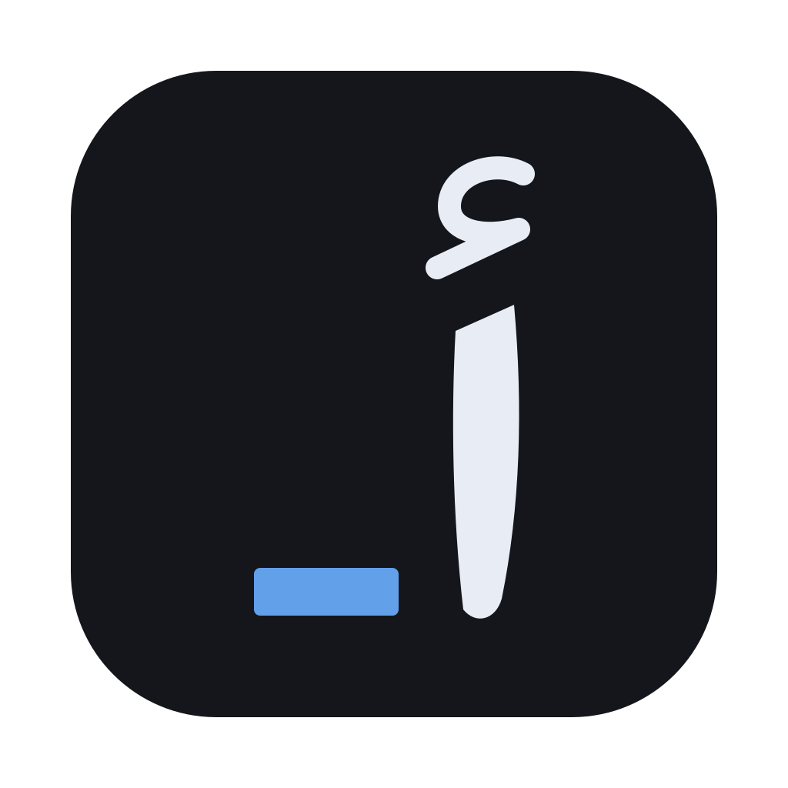
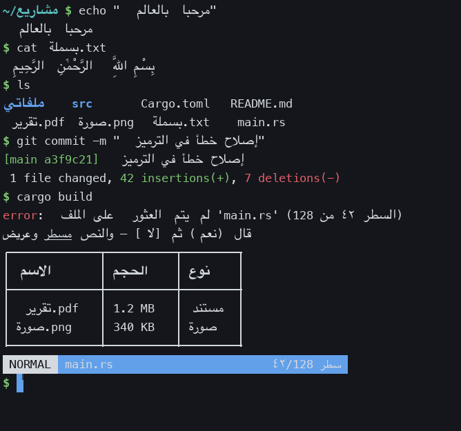
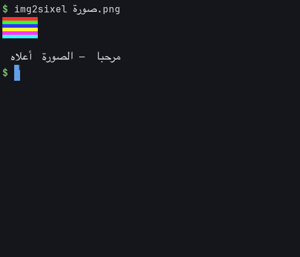

# Alef

An Arabic-first terminal emulator, written in Rust. Alef (ألف) is the first
letter of the Arabic alphabet.

Arabic breaks in most terminals for a structural reason: a terminal is a grid of
fixed cells, but Arabic needs the opposite of fixed cells. Letters change shape
depending on their neighbours, some pairs must fuse into a single glyph, vowel
marks stack on top of the letter they belong to without taking any width, and
the whole line runs right-to-left while any numbers or Latin words inside it
still run left-to-right. A terminal that stamps one glyph per cell cannot do
any of that, so Arabic comes out as disconnected letters in the wrong order.

Alef keeps the grid — every column stays exactly one cell wide, so
`vim`, `htop` and `git log --graph` keep working — and does the Arabic work at
draw time instead.



## How it works

**The grid stores logical order.** Cells hold exactly the characters the program
wrote, in the order it wrote them. Nothing is reordered or pre-shaped in
storage, so the column arithmetic every full-screen program relies on stays
true, and copying text gives back what the program actually emitted.

**Reordering and shaping happen at render time**, per row:

1. **Segment.** The row is cut at *reorder barriers* — box-drawing characters
   and any run of two or more blanks. Text reorders freely inside a field, but
   never across one. This is what stops a single Arabic word from dragging a
   table's column separator, or a whole `ls` column, across the screen.
2. **Resolve.** Each segment goes through the Unicode Bidirectional Algorithm
   (UAX #9) to get runs of uniform direction, in visual order.
3. **Assign columns.** Each run's cells are laid onto the columns it owns —
   reversed for a right-to-left run. This is a *permutation of cells onto
   columns*, never a change of column widths, so backgrounds, selection, the
   cursor and mouse hit-testing stay exact.
4. **Shape.** Each run is shaped whole by [rustybuzz], so letters join across
   cell boundaries, لا becomes one ligature, and diacritics get their proper
   GPOS anchors. Runs are split by font, **never by colour** — a colour change
   in the middle of a word must not break the joining.
5. **Place.** Cursive Arabic is placed as one piece, with the font's own
   advances, inside the columns its word occupies. Everything else is snapped
   to its cell — `cell_w` is a whole number of pixels but a glyph advance is
   not, so a long Latin run laid out by advances drifts about a third of a pixel
   per character and collides within one status bar's width. Snapping is safe
   there precisely because Latin has no joins to protect.

**Pre-shaped Arabic is undone on the way in.** Editors that predate shaping
terminals convert Arabic to Arabic Presentation Forms before writing it out —
vim and neovim do this by default, via `'arabicshape'`. Those codepoints are
frozen letter shapes, so passing them to a real shaper yields disconnected
letters. Each one that maps back to a single base letter is restored, including
hamza and madda letters such as `إ أ ؤ ئ آ`. Compatibility decomposition is
followed by canonical recomposition so their marks do not get mistaken for
extra letters. This prevents boxed characters in fonts such as Scheherazade New
and lets the shaper join properly. Multi-character ligature forms retain their
single cell so the editor's following columns do not move.

### Two decisions worth explaining

**Base direction is automatic within each field by default.** An Arabic
sentence such as `افتح الملف README ثم احفظ التغييرات` needs an RTL base so
that the phrases on either side of `README` stay in sentence order; the English
word itself still reads left-to-right. Table separators and multiple-space
column gutters stay fixed. Common shell prefixes (`$`, `%`, `#`, `>`, `❯`,
`➜`) and path-like first tokens retain an LTR base, and so does a field with
more Latin letters than Arabic ones: an English sentence that merely opens
with an Arabic word stays left-to-right. This is a terminal policy
on top of the [Unicode Bidirectional Algorithm](https://www.unicode.org/reports/tr9/),
not an attempt to parse every shell or programming language. For ambiguous
output, set `bidi_mode = "ltr"` or `"rtl"`, or press `Cmd R` to cycle through
auto → LTR → RTL. Text storage and copying always remain in logical order.

**The Arabic font is scaled to match the cell.** Naskh faces set much narrower
on the em than a monospace Latin face, so Arabic drawn at the Latin size looks
thin and detached from its columns. The scale is derived at startup by shaping
sample words and comparing their width to the columns they would occupy, then
backing off slightly — overshooting is worse than undershooting, because a word
wider than its columns spills into its neighbour and swallows the space between
words. Override with `--arabic-scale` if you prefer.

Box-drawing characters are drawn procedurally rather than from the font, because
the line box is taller than the monospace face's natural line — it has to be, to
leave room for stacked diacritics — and font glyphs would no longer tile.

### Stated policies

These are deliberate choices, not omissions:

- **No contextual digit substitution.** `123` is displayed as `123`, never as
  `١٢٣`. The terminal shows the codepoints the program sent; anything else makes
  `grep`, column arithmetic and copy/paste disagree with the screen.
- **No kashida justification.** Slack goes to the gaps between words, not into
  synthetically elongated letters.
- **Copy yields logical order**, which is what a shell expects back.
- **Paste is sanitised**: control characters are stripped, so a pasted
  right-to-left override cannot make a command line display as something other
  than what runs.

## Install

Alef runs on macOS and Linux. Downloads are on the
[releases page](https://github.com/almodhfer/alef-term/releases).

**macOS (Apple Silicon).** Download `Alef-<version>-macos-arm64.zip`, unzip it
and move `Alef.app` to Applications. The app is not signed with an Apple
developer certificate, so macOS refuses to open it the first time. Either
right-click the app, choose Open, and confirm, or clear the download flag:

```sh
xattr -dr com.apple.quarantine /Applications/Alef.app
```

**Linux (x86-64).** Download `alef-term-<version>-linux-x86_64.tar.gz`, then:

```sh
tar -xzf alef-term-*-linux-x86_64.tar.gz
cd alef-term-*-linux-x86_64 && ./install.sh
```

This installs the executable to `~/.local/bin` and adds a launcher entry.

**From source.** You need Rust 1.85 or newer.

```sh
git clone https://github.com/almodhfer/alef-term && cd alef-term
make run       # macOS: build Alef.app and open it
make install   # Linux: install to ~/.local/bin with a launcher entry
```

The package and its executable are named `alef-term`.

## Build and run

From the project directory on macOS:

```sh
make run       # build and open the macOS app
make restart   # rebuild, close existing sessions, and reopen the app
make test      # run the test suite
```

On Linux:

```sh
make install   # build, then install to ~/.local/bin with a launcher entry
make run       # build and open a window from this checkout
make restart   # rebuild, close existing sessions, and reopen
make test      # run the test suite
```

`make install` puts the executable in `~/.local/bin`, an icon in
`~/.local/share/icons`, and `alef-term.desktop` in
`~/.local/share/applications`, so Alef appears in the application
launcher and its windows are grouped under its icon. Run it again to update.
`PREFIX` and `XDG_DATA_HOME` choose other locations.

`make restart` works from inside Alef too. It finishes the build before
closing running Alef app instances, including copies launched from the
Dock or Finder, then opens the newly built app in the background. Restarting
closes those windows and their shell sessions. Relaunch errors are recorded in
`target/restart.log`. Run `make help` to list the available commands.

To build or run the executable directly:

```sh
cargo build --release
./target/release/alef-term
```

`scripts/bundle.sh` builds `target/bundle/Alef.app`, with an icon, for
the Dock, Spotlight and `open`. Or build and launch in one step with `cargo run --release`. Plain `cargo run`
selects the development build even after `cargo build --release`; the development
profile also enables optimization so scrolling and text shaping remain responsive.

Requires Rust 1.85+. On Linux, drawing uses Vulkan, falling back to software
rendering when no Vulkan driver is present; both X11 and Wayland support are
built in. Fonts are picked in this order:

| Slot | Preferred | Falls back to |
| --- | --- | --- |
| monospace | JetBrains Mono Nerd Font Mono (`~/Library/Fonts`, `~/.local/share/fonts`) | Menlo, DejaVu Sans Mono, Liberation Mono |
| Arabic | Geeza Pro (macOS), Noto Naskh Arabic (Linux) | Noto Sans Arabic, Amiri, DejaVu Sans |
| icons | whatever the monospace face covers | Symbols Nerd Font Mono |
| emoji | Apple Color Emoji (macOS), Noto Color Emoji (Linux) | |

Characters none of these cover — Chinese, Japanese, Korean, Hebrew,
Devanagari, Thai and the rest — are drawn with whichever installed font has
them, trying well-known faces first (Noto Sans CJK, PingFang, Hiragino, Noto
Sans Hebrew, Noto Sans). Each character is looked up once; only the fonts'
character maps are read while searching. Private-use codepoints are left to
the icon font, since each font gives them a different meaning.

A Nerd Font is preferred for monospace because it carries the private-use icons
that status bars, file trees and workspace managers draw with; without one they
render as empty boxes. The "Mono" cut keeps those icons one cell wide.

```
--font-size <px>              base font size (default 15)
--arabic-scale <f>            Arabic face scale (default: derived from metrics)
--line-height <1..2>          line spacing multiplier (default 1)
--bidi-mode <auto|ltr|rtl>    text direction (default auto)
--size <cols>x<rows>          initial grid size (default 96x28)
--working-directory, -d <p>   starting folder
--exec, -e <cmd>              run a command in the first session
--scroll-lines <n>            lines per wheel notch (default 3)
--touch-scroll <f>            trackpad scroll speed (default 3)
--no-alternate-scroll         do not turn the wheel into arrow keys
--theme <name>                colour theme (default dark)
--list-themes                 print the built-in themes
--renderer <gpu|software>     drawing backend (default gpu)
--config <path>               settings file
--check-config                validate settings without opening a window
```

Set `ALEF_TERM_PROFILE=1` to print per-phase frame times to stderr.

### Configuration

Settings live in `~/.config/alef-term/config.toml` (or the file named by
`$ALEF_TERM_CONFIG` or `--config`). Every key is optional and flags override
the file; a typo is reported on startup rather than ignored. See
[`docs/config.example.toml`](docs/config.example.toml) for the full list: fonts,
size, scrollback, scroll speed, cursor shape and blink, the visual bell, the
theme, and `#rrggbb` overrides for the foreground, background, cursor,
selection and the 16 ANSI colours.

The grid has 12 logical pixels of horizontal padding and 10 vertically; these
insets scale with Retina displays. The default line box fits both fonts, and
`line_height` adds leading without stretching glyphs. The initial window size
includes these margins, so `cols` and `rows` describe the usable grid. Light
box-drawing strokes follow the font's column width, so increasing line spacing
does not make borders heavier.

```toml
padding_x = 12
padding_y = 10
line_height = 1.0           # 1.0..2.0, based on the shared Arabic/Latin line box
bidi_mode = "auto"         # auto | ltr | rtl
```

### Arabic font styles

Press `Cmd Shift F` to choose an Arabic font, or open `Cmd Shift P` and type
`Arabic font`. Four installed-family presets are offered:

| Font | Character |
| --- | --- |
| Noto Naskh Arabic | Clear, balanced Naskh |
| Amiri | Traditional book Naskh |
| Scheherazade New | More calligraphic Naskh |
| Geeza Pro | Familiar macOS Arabic |

Enter applies the choice to every open terminal and saves `arabic_font` in the
configuration. The Latin font and column width stay unchanged; row height adapts
to each Arabic face, including stacked marks in bold. Taller calligraphic fonts
show fewer rows in the same window. Noto Naskh's variable weight is applied to
both shaping and drawing, so bold Arabic is actually bold. Fonts are loaded from
the system, not bundled: an unavailable choice reports that it is missing and
keeps the current font. Repeated switching reuses font data already in memory.

`cargo run --example arabic_fonts` renders comparison samples through the same
shaper and renderer as the app. Set `OUT_DIR` to choose the output directory.

### Everyday use

Shortcuts below are given for macOS; Linux uses `Ctrl Shift` instead of `Cmd`,
as listed under [Linux](#linux).

`Cmd Shift P` opens a searchable command palette. Type a few words, use the
arrow keys, and press Enter. It includes tabs, windows, search, themes,
clipboard actions, zoom, settings reload, and explicit text-direction choices.

On macOS, `Cmd T` opens a native tab with an independent shell. `Cmd Shift [`
and `Cmd Shift ]` switch tabs; `Cmd 1` through `Cmd 8` choose a tab, and `Cmd 9`
selects the last one. `Cmd N` starts a separate window, and `Cmd W` closes only
the current tab. Shell-provided titles appear in the tab bar; otherwise sessions
are numbered. Hidden tabs still receive output, but do not repaint until shown.

Command shortcuts remain available with an Arabic keyboard layout active.
`Cmd A` selects all available text, and `Cmd C` copies it. Selecting text alone
keeps the clipboard intact; set `copy_on_select = true` for automatic copying.
Hold Shift while dragging to select text inside mouse-aware programs such as
editors. Dragging files into the window inserts quoted shell paths. Pasted
CRLF, CR and LF line endings are normalized consistently, while Arabic marks
and joiners are preserved. `Cmd K` clears scrollback and keeps the live screen.

`Cmd V`, the Paste command, and middle-click also accept copied files and
screenshots. Copied files insert their quoted paths; an image on the clipboard
is saved as a PNG in the system temporary directory and its quoted path is
inserted. These temporary images remain available after the terminal closes,
until the system cleans them up. Search and picker fields accept text only.

`Cmd Shift R` reloads settings in every open tab and window. Invalid settings
leave running sessions unchanged and show a message. Removing a setting restores
its default; command-line overrides still take precedence. Fonts, spacing,
themes, direction, cursor, scroll tuning, and clipboard preferences apply live.
Renderer selection, initial dimensions, and starting directory apply to new
sessions. `Cmd 0` resets to the configured font size. Validate the file without
opening a window with `alef-term --check-config`.

Programs can raise notifications — a finished build, an agent waiting for
input — with OSC 9 (iTerm2's form), OSC 777 (urxvt's, also Ghostty's) or
OSC 99 (kitty's). While the window has focus they appear as a notice inside
it; otherwise they go to the desktop, at most one a second, and the window
asks for attention, as it also does when the bell rings in the background.

Set `working_directory = "~/projects"`, or use `--working-directory <path>`, to
choose the initial folder. Otherwise a shell inherits the launch directory;
Dock/Finder launches from `/` start at home. New sessions use the current shell's
folder when it reports OSC 7. `--exec` runs only in the first session. Missing
UTF-8 locale defaults and the unsupported macOS `C.UTF-8` locale are repaired
for child processes, while explicit supported locale preferences are preserved.

### Themes

Eighteen themes are built in: the default `dark` and `light`, Dracula, Nord,
Gruvbox (dark and light), Solarized (dark and light), Tokyo Night, Catppuccin
(Mocha and Latte), One Dark, Monokai, GitHub (dark and light), Rosé Pine,
Kanagawa and Everforest. `alef-term --list-themes` prints their names.

Press `Cmd Shift T` to pick one from inside the terminal. The list is filtered
as you type, the window previews the theme under the highlight, `Enter` keeps
it and `Esc` goes back. The choice applies to every open window and is saved as
the `theme` line of the configuration file; nothing else in the file is
touched, and a file with an error in it is left alone. `[colors]` overrides
apply on top of whichever theme is chosen.

Selection and search highlights keep coloured text where it is readable and
use a contrasting foreground where needed. Dim text blends toward its cell
background in both light and dark themes. A terminal reset keeps the selected
theme, including configured colour overrides.

Text has a configurable contrast floor (`minimum_contrast = 4.5`). Pale RGB
and 256-colour text from applications started in dark mode remains readable
when switching to light. Only unreadable foreground ink is adjusted, retaining
its colour; backgrounds, images, block art and Powerline surfaces stay exact.
Dim text uses a lower floor so it remains secondary. Set `minimum_contrast = 1`
to preserve application colours exactly, and press Cmd Shift R to apply it.

Full-screen applications can also have their own themes. Alef reports
its current colours and light/dark appearance; applications that draw explicit
RGB or 256-colour backgrounds must choose their own matching light scheme.
For [Herdr](https://herdr.dev/docs/configuration/#theme), enable this in
`~/.config/herdr/config.toml` on each machine:

```toml
[theme]
auto_switch = true
dark_name = "catppuccin"
light_name = "catppuccin-latte"
```

Shared `[theme.custom]` overrides in Herdr apply to both appearances. Put dark
background overrides under `[theme.custom.dark]` and light ones under
`[theme.custom.light]` so sidebar and selection backgrounds follow the switch.

| Key | Action |
| --- | --- |
| `Cmd` `+` / `-` / `0` | font size |
| `Cmd R` | cycle base direction: auto → LTR → RTL |
| `Cmd Shift T` | choose a theme, previewed live; type to filter, `Enter` keeps it, `Esc` cancels |
| `Cmd T` / `Cmd N` / `Cmd W` / `Cmd Q` | new native tab / new window / close current tab / quit |
| `Cmd Shift [` / `Cmd Shift ]` | previous / next tab |
| `Cmd 1` … `Cmd 9` | choose a tab; 9 selects the last |
| `Cmd Shift P` | searchable command palette |
| `Cmd Shift R` | reload settings without restarting sessions |
| `Cmd A` / `Cmd K` | select all text / clear scrollback |
| `Cmd C` / `Cmd V` | copy / paste |
| `Cmd F` | search the scrollback; `Enter` / `Shift Enter` (or the arrows) step to older / newer hits, `Cmd G` likewise, `Esc` closes |
| double / triple click | select a word / a whole line, soft wraps included |
| `Cmd` + click | open the link under the pointer (OSC 8 or a bare URL); hold `Cmd` to see it underlined |
| scroll wheel | smooth scrollback, or the application if it grabbed the mouse |
| `Shift` + wheel | always the terminal's own scrollback |
| `Shift` `PgUp` / `PgDn` | scroll by a page |
| `Shift` `Home` / `End` | oldest line / back to the live screen |
| `Shift` `↑` / `↓` | previous / next prompt, when the shell marks them with OSC 133 |

### Linux

Linux desktops reserve Super for themselves, so shortcuts move to `Ctrl Shift`,
as in GNOME Terminal, Konsole and kitty. Plain `Ctrl` keys still reach the
program — `Ctrl C` interrupts, `Ctrl W` deletes a word — apart from zoom, and a
`Ctrl Shift` key that is not a shortcut is passed on as well.

| Key | Action |
| --- | --- |
| `Ctrl Shift C` / `Ctrl Shift V` | copy / paste |
| `Ctrl Shift P` | command palette, which also holds the theme, Arabic font and reload commands |
| `Ctrl Shift F` | search the scrollback; `Ctrl Shift G` steps like `Cmd G` |
| `Ctrl Shift R` | cycle base direction: auto → LTR → RTL |
| `Ctrl Shift A` / `Ctrl Shift K` | select all text / clear scrollback |
| `Ctrl Shift T` / `Ctrl Shift N` | new tab / new window |
| `Ctrl Shift W` / `Ctrl Shift Q` | close tab / quit |
| `Ctrl Tab` / `Ctrl Shift Tab` | next / previous tab; `Ctrl PgDn` / `Ctrl PgUp` too |
| `Ctrl Shift 1` … `Ctrl Shift 9` | choose a tab; 9 selects the last |
| `Ctrl` `+` / `-` / `0` | font size |
| `Ctrl` + click | open the link under the pointer |
| `Ctrl` + `Backspace` | clear the palette, picker or search field |
| select / middle click | set / paste the primary selection |

On macOS tabs are the system's own window tabs. Linux has no such thing, so
Alef draws them: a window with more than one tab shows a bar across its
top, one tab per session sharing the width, and a click on a tab shows it.
Hidden tabs keep reading their shell's output but draw nothing until shown.
Closing the window closes all its tabs. Geeza Pro, which only macOS ships, is
left out of the palette.

## Known limitations

- **Linux is new.** It has been run on Ubuntu 24.04 with GNOME on X11 and an
  NVIDIA GPU; Wayland sessions and other GPUs have not been tried yet. Windows
  is not supported.
- **Indic scripts are drawn one syllable per cell.** Devanagari and its
  relatives are legible but look spaced out, as in most terminals.
- **IME composition is not drawn.** Committed text from an input method arrives
  correctly, but the text being composed is not shown while it is typed.

## What's implemented

Colours (16 / 256 / truecolour, both `;` and `:` SGR forms), bold/dim/italic/
strikeout/inverse, underlines in five styles — straight, double, wavy, dotted
and dashed — with their own colour (`SGR 4:n`, 21, 58, 59) as editors use for
diagnostics, cursor addressing, erase and insert/delete of
characters and lines, `DECSTBM` scroll regions, the alternate screen, scrollback,
autowrap with deferred wrap at the margin, wide (CJK) characters with spacers,
combining marks, DEC line-drawing charset, bracketed paste, focus events, window title (OSC 0/2), palette changes (OSC 4),
hyperlinks (OSC 8), default colour set/query/reset (OSC 10/11/12, 104, 110–112) so
programs can learn the background and pick a theme, light/dark scheme reports
(`CSI ?996n`, and mode 2031 to be told when the theme changes), the working directory
(OSC 7) and prompt marks (OSC 133) for jumping between commands, cursor shape (DECSCUSR:
block, underline, bar, blinking or steady), a visual bell, desktop notifications (OSC 9, 777 and 99), clipboard writes (OSC 52), synchronized output (?2026) so
full-screen programs do not tear mid-repaint, mode reporting (DECRQM) so they
can detect it, device status reports, mouse
reporting (click, drag, any-motion, wheel; legacy and SGR), the kitty
keyboard protocol's disambiguation flag, images via both sixel and the kitty
graphics protocol, selection and clipboard, and resize propagated to the child
via `TIOCSWINSZ`. Resizing reflows: rows broken by autowrap are joined back into
the lines the program wrote and re-broken at the new width, in the screen and
the scrollback, with the cursor and any images following their text. Explicit
newlines are kept and the alternate screen is left to the program that owns it.

Images — sixel, or the kitty graphics protocol — are pinned to the line they
were drawn on, so they scroll with their text:



## Testing

```sh
cargo test
```

The test suite covers: VT and grid behaviour; the built-in themes, the theme
picker and saving its choice; font coverage and fallback; the
Arabic layout itself (reordering, ligatures, diacritics, bracket mirroring,
column pinning, cell-grid alignment, joining across a soft wrap); key encoding
including the kitty protocol; selection and copy; sixel and kitty graphics
decoding; mouse event encoding; synchronized output and its watchdog; scroll
easing, coalescing, and its interaction with incoming output; and end-to-end
tests that drive a real shell — and a real editor — over a PTY, typing Arabic
through the key encoder and interrupting a running command with Ctrl+C.

`cargo run --release --example tui_probe -- /bin/sh "htop\n<<PAUSE>>"` drives a
full-screen program through the terminal and dumps both the grid and a render,
which is how the editor and htop cases above were verified.

`cargo run --release --example render_test` renders a showcase screen to a file
without opening a window, which is handy for eyeballing layout changes.
Add `-- --theme light --highlights` to check selection, search and dim text in
a light theme; `OUT=/tmp/theme.ppm` sets the output file.
`cargo run --release --example bench` reports frame times for a static screen,
a screen with one row changed, and a screen with every row changed — the last
being what a multiplexer produces whenever one pane scrolls, since each row
mixes content from several panes — first through the software canvas and then
through the GPU, where the CPU cost of building and submitting the frame is
reported separately from the wait for the GPU to finish, since the app never
waits. Compositing is where the GPU pays off: a static Retina QHD frame
(75×284 cells, 5120×3679 px) costs about 0.4 ms of CPU against 5 ms of software
blitting, and the running app's draw phase averages a quarter of a millisecond
at that size. A frame where every row changed costs about 4 ms either way,
because that is layout and shaping: the rustybuzz shaping plan is built once
per face and script rather than once per word, and glyph and layout caches
are keyed through a folded-multiply hasher rather than SipHash.

## Design notes

### Mouse wheel

The wheel goes to the application when it has asked for mouse events, and to
the terminal's own scrollback otherwise; `Shift` always chooses the scrollback.
Scrolling back is not disturbed by output arriving underneath it — the view
follows the retiring lines so the same text stays on screen, and only snaps to
the bottom when it was already there or when you type.

### Scrolling

Scrolling is smooth at sub-line precision, with wheel events coalesced so a
burst of trackpad ticks costs one redraw rather than one each, and the easing is
framerate-independent.

Redraws are paced to the monitor's refresh rate, with immediate updates after
idle. PTY wakes are coalesced and queued output is bounded to 1 MiB. Each event-loop
turn parses at most 128 KiB or about 2 ms of output (checked between 16 KiB chunks),
then yields to input before continuing, so a busy full-screen program cannot
monopolize the UI with a multi-megabyte parse pass.
Input writes run on a separate thread so a child that stops reading cannot
freeze mouse and keyboard handling.

### Search

`Cmd F` opens a bar at the top right, seeded with the selection if there is
one. Typing narrows as you go, every hit is highlighted, the view jumps to the
nearest one above the bottom of the screen, and `Enter` walks back through
history. Case is ignored unless the query has a capital; Arabic vowel marks in
the query are ignored, so a word typed without harakat finds text written
with them; spellings Arabic writers use interchangeably find each other, as
in Arabic search engines — أ إ آ ٱ and ا, ى and ي, ة and ه — so `احمد` finds
`أحمد`; a hit broken by the margin is still found and highlighted on both
rows. The grid is flattened into one string and searched with a SIMD
substring finder: forty thousand lines index in about 15 ms, only when the
content changed, and a query over them takes a millisecond or two.

### Rendering

Layout, shaping and glyph rasterisation happen on the CPU; only compositing
is on the GPU, through [wgpu]. The renderer emits rectangles, glyphs and
images to a `Target` trait, and the GPU target turns each into one instanced
quad: glyphs are rasterised by swash once and uploaded to an atlas, images
become textures, and the quads are drawn in emission order so layering is
identical to the software canvas. The software canvas is kept as the second
`Target`: the headless tests and examples render through it, the window falls
back to it (through softbuffer) when there is no usable GPU or when the
configuration says `renderer = "software"`, and `tests/gpu.rs` renders a busy
screen both ways and requires every pixel to match within rounding.

It deliberately does **not** do damage tracking. Repainting a whole frame is a
few thousand quads, cheaper than the bookkeeping to avoid it, so the renderer
repaints whole frames and spends its effort on not drawing frames nobody asked
for.

## Source layout

| | |
| --- | --- |
| `src/layout.rs` | bidi, segmentation, shaping, glyph placement — the core |
| `src/term.rs` | VT/ANSI interpretation |
| `src/grid.rs` | cells, rows, screens, scrollback |
| `src/render.rs` | software rasterisation and blending |
| `src/font.rs` | font loading, script fallback, glyph cache |
| `src/boxdraw.rs` | procedural box-drawing glyphs |
| `src/commands.rs` | command palette and action filtering |
| `src/input.rs` | layout-independent shortcuts, paste normalization, path quoting |
| `src/cli.rs` | validated command-line options |
| `src/keys.rs` | key presses to terminal byte sequences |
| `src/frame_hold.rs` | withholding frames during a synchronized update |
| `src/scroll.rs` | scroll position and easing |
| `src/selection.rs` | selection, words, lines and links |
| `src/search.rs` | scrollback search |
| `src/sixel.rs` | sixel image decoding |
| `src/kitty_graphics.rs` | kitty graphics protocol |
| `src/pty.rs` | PTY and the shell process |
| `src/gpu.rs` | GPU compositor: glyph atlas, image textures, instanced quads |
| `src/config.rs` | the configuration file |
| `src/app.rs` | window, input, event loop |

Built on [rustybuzz] (shaping), [swash] (rasterisation), [unicode-bidi] (UAX #9),
[vte] (ANSI parsing), [portable-pty], [winit] and [wgpu].

## License

MIT. See [LICENSE](LICENSE).

[rustybuzz]: https://github.com/harfbuzz/rustybuzz
[swash]: https://github.com/dfrg/swash
[unicode-bidi]: https://github.com/servo/unicode-bidi
[vte]: https://github.com/alacritty/vte
[portable-pty]: https://github.com/wez/wezterm
[winit]: https://github.com/rust-windowing/winit
[wgpu]: https://github.com/gfx-rs/wgpu
